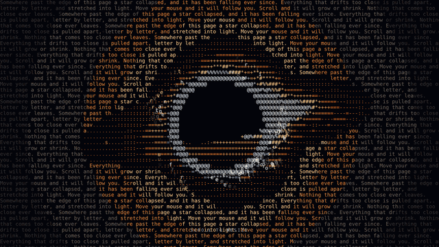

<div align="center">

# ASCII Black Hole

**A black hole made of text. It follows your mouse, eats the letters in its path, and grows or shrinks as you scroll.**


[**Live demo**](https://prithviraj5004.github.io/Ascii-Horizon/) · [Quick start](#quick-start) · [Controls](#controls) · [Options](#options) · [How it works](#how-it-works)



</div>

---

## Features

- **Made entirely of text.** Every pixel is a character. The accretion disk glows from deep red to white-hot, with a blue-white photon ring around the hole.
- **It eats.** Letters near the hole warm up, break loose and spiral in. A few seconds later they grow back, so there is always something to eat.
- **It follows you.** The hole trails your cursor with a heavy, smooth lag. Leave it alone and it keeps revolving in place.
- **Scroll to resize.** Mouse wheel, swipe or arrow keys make it bigger or smaller. It gets huge, but it never goes away.
- **One file, nothing to install.** Plain JavaScript on a 2D canvas: no dependencies, no build step, about 21 KB unminified.
- **Kind to motion settings.** With "reduce motion" turned on in the OS, the ambient motion (spinning disk, drift, twinkling stars) slows to a quarter of its speed. It still responds to your mouse and scrolling.

## Quick start

Drop the file next to your page and add one script tag. It works from `<head>` or the end of `<body>`.

```html
<script src="ascii-blackhole.js"></script>
```

To change settings, add a config block **before** the script:

```html
<script>
  window.ASCII_BLACKHOLE = { text: 'your own words here', scrollDistance: 3 };
</script>
<script src="ascii-blackhole.js"></script>
```

**From a CDN** (pin a release tag so it never changes under you):

```html
<script src="https://cdn.jsdelivr.net/gh/YOUR-USERNAME/ascii-blackhole@v1.0.0/ascii-blackhole.js"></script>
```

**Vite / React / Next.** Put `ascii-blackhole.js` in `public/` and add `<script src="/ascii-blackhole.js"></script>` to `index.html`. It is a plain script, so it needs no import and no changes to your components.

**Run it locally.** Clone the repo and open `index.html`. No server needed.

```bash
git clone https://github.com/YOUR-USERNAME/ascii-blackhole.git
cd ascii-blackhole
open index.html        # or just double-click it
```

> The black hole takes over the whole page: it is a full-screen, fixed layer that uses the scroll wheel for resizing, so the page underneath will not scroll. Call `AsciiBlackHole.destroy()` to remove it.

## Controls

| Input | What it does |
|---|---|
| Move the mouse | The hole follows, and eats the text in its path |
| Scroll wheel down | Grows (up shrinks). Set `invertScroll: true` to flip it |
| Swipe up / down (touch) | Grows / shrinks. On touch screens the hole stays near the center |
| <kbd>↓</kbd> <kbd>PgDn</kbd> <kbd>Space</kbd> | Grow |
| <kbd>↑</kbd> <kbd>PgUp</kbd> | Shrink |
| <kbd>End</kbd> / <kbd>Home</kbd> | Biggest / smallest |

Keys are ignored while you type in an input, and combinations with <kbd>Ctrl</kbd>, <kbd>Cmd</kbd> or <kbd>Alt</kbd> are left to the browser. <kbd>Ctrl</kbd> + wheel and trackpad pinch-zoom still zoom the page as usual.

## Options

Set them on `window.ASCII_BLACKHOLE` before the script loads.

| Option | Default | What it does |
|---|---|---|
| `text` | a short poem | The text that fills the screen. Printable ASCII only, anything else becomes a space |
| `hint` | `'scroll to resize'` | Small caption at the bottom until the first scroll. Use `''` to hide it |
| `bg` | `'#03040a'` | Background color |
| `font` | a monospace stack | Any monospace font (CSS `font-family` value) |
| `scrollDistance` | `2` | About how many screen-heights of scrolling it takes to go from smallest to biggest. Bigger = slower |
| `invertScroll` | `false` | `true` = scrolling up makes it bigger |
| `maxSize` | `0.46` | Radius at full size, as a fraction of the shorter screen side |
| `startSize` | `0` | How big it is on load, from `0` (smallest) to `1` (biggest) |

## API

```js
AsciiBlackHole.setSize(0.5);   // 0 = smallest, 1 = biggest
AsciiBlackHole.getSize();      // current size (0..1, smoothed)
AsciiBlackHole.destroy();      // remove the canvas and every listener
```

## How it works

It is a stylized look, not a physically exact simulation (there is no ray tracing).

1. **A grid of characters.** The screen is split into character cells, capped at about 9,000 so it stays fast. The text is typeset into that grid.
2. **Every cell picks what to show.** Inside the hole: nothing. On the accretion disk: a bright character from the ramp `.:-=+*#%@`, driven by a noisy pattern that spins faster near the center, with the side moving toward you drawn brighter. Light from the far side of the disk is bent over the top and under the bottom, and a thin photon ring hugs the edge. Anywhere else: the page text, or an occasional twinkling star.
3. **Pre-drawn glyphs.** Every character in every color is rendered once into a sprite sheet, so each frame is just one `drawImage` per cell.
4. **Eating.** Letters inside 1.5 hole radii are removed. A selection of them become particles that spiral in faster as they get close and flare the ring when they arrive. After a few seconds they regrow, once they are outside the capture area.
5. **Size and motion.** Scroll sets a target size; the real size eases toward it (growth is exponential, so small and large feel equally easy to control). The position eases toward the cursor with a slow wobble added.

## Project structure

```
ascii-blackhole/
├── ascii-blackhole.js     the whole library
├── index.html             the demo page
├── docs/
│   ├── preview.gif        animation at the top of this README
│   └── social-preview.png link-preview image (1280×640)
├── README.md
└── LICENSE
```

## Browser support

Any modern browser with Canvas 2D. Developed and tested in Chromium; Firefox and Safari should work since it only uses standard canvas calls, so please open an issue if something looks off.

## Deploying the demo

1. Push this repo to GitHub.
2. Go to **Settings → Pages**, choose **Deploy from a branch**, pick `main` and `/ (root)`, and save.
3. After a minute the demo is live at `https://YOUR-USERNAME.github.io/ascii-blackhole/`.

## Contributing

Issues and pull requests are welcome. Some ideas: a mode that sits behind page content, a color-theme option, a WebGL renderer for even more detail, or mouse-follow on touch screens.

## Credits

Inspired by [SiddDevZ/horizon](https://github.com/SiddDevZ/horizon), a WebGL 2 ray-traced black hole that bends a page of text. This project is an independent, lightweight 2D-canvas take on the same idea and shares no code with it.

## License

[MIT](LICENSE) © Prithviraj Salunke
